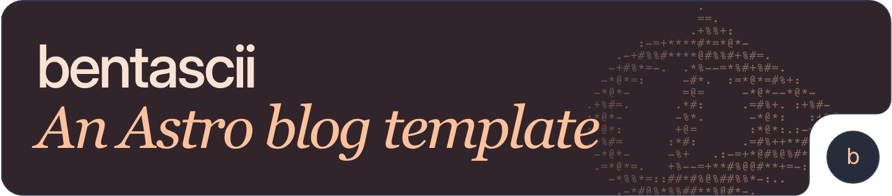
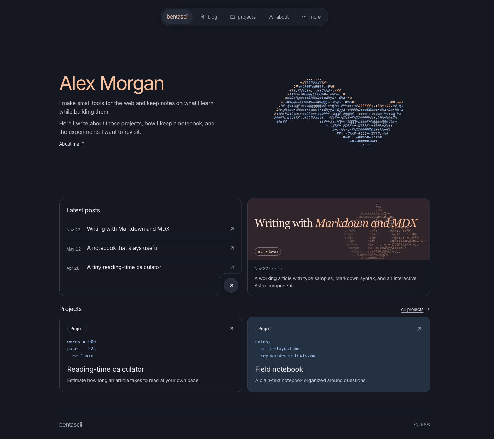
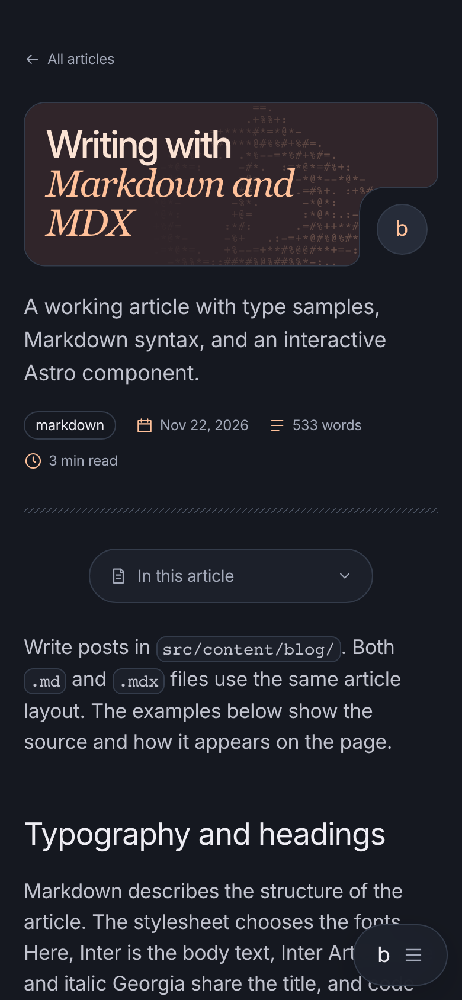

# 

**bentascii** is a personal blog template built with Astro, Markdown, and MDX. Its homepage pairs a short bio and static ASCII art with a bento grid for recent articles and projects. The article layout includes a table of contents, reading time, and an ASCII header generated from each title.

The template comes with a searchable archive, topic pages, About and Projects pages, and an RSS feed. Readers can switch between dark, light, and sand themes.

[View the live demo](https://guisso.dev/bentascii/)

## Run locally

Use Node.js 22.23.4 or later. Select **Use this template** on GitHub to create your repository, then substitute its URL and directory name below.

```sh
git clone https://github.com/YOUR-NAME/YOUR-BLOG.git
cd YOUR-BLOG
npm ci
npm run dev
```

Open [http://127.0.0.1:4321/](http://127.0.0.1:4321/). The dev server updates the preview as you edit files.

## Preview



<details>
<summary>Mobile article preview</summary>

<p>
  
</p>

</details>

## Make it your own

| To change | Edit |
| --- | --- |
| Site name, author, bio, and description | [`src/site.config.ts`](src/site.config.ts). The `mark` setting supplies the mobile monogram, article badge, and favicon. |
| About and Projects content | [`src/pages/about.astro`](src/pages/about.astro) and [`src/components/ProjectBoard.astro`](src/components/ProjectBoard.astro). The project cards appear on the homepage and the Projects page. |
| Theme colors and font families | [`src/styles/global.css`](src/styles/global.css). Each theme defines its own color values. |
| Article text, headings, code blocks, and tables | [`src/styles/reading.css`](src/styles/reading.css). |

Replace the example articles in [`src/content/blog/`](src/content/blog/). The sample project cards link to two of those articles, so update their links when you remove the examples.

## Write an article

Create `src/content/blog/first-post.md`. The filename becomes the slug, so this post appears at `/blog/first-post/`.

```markdown
---
title: My first post
description: A short note on starting this blog.
pubDate: 2026-11-22
tags: [notes, web]
---

I started this blog to keep track of small projects and what I learn from them.

## The first project

This section appears in the article's table of contents.
```

The frontmatter fields are defined in the [blog collection schema](src/content.config.ts).

| Field | Required | Purpose |
| --- | --- | --- |
| `title` | Yes | Title shown in the article and archive. |
| `description` | Yes | Summary shown on the article, in the archive, and in RSS. |
| `pubDate` | Yes | Publication date in `YYYY-MM-DD` format. |
| `tags` | No | Lowercase topics such as `web` or `field-notes`. |
| `updatedDate` | No | Date shown alongside the publication date after a revision. |
| `draft` | No | Set to `true` to omit the post from the generated site and feed. |

### Add an interactive example with MDX

Use `.mdx` when a post needs a component. Keep the same frontmatter, then put the import before the article body. This example imports an Astro component into a post placed directly in `src/content/blog/`.

```mdx
import ReadingCalculator from '../../components/ReadingCalculator.astro';

## Estimate your reading time

<ReadingCalculator />
```

The [Markdown and MDX example article](src/content/blog/writing-with-markdown-and-mdx.mdx) includes type samples and examples of headings, lists, tables, and code blocks. See the [Astro MDX guide](https://docs.astro.build/en/guides/integrations-guide/mdx/) for more on using components.

## Build and deploy

### GitHub Pages

The [included workflow](.github/workflows/pages.yml) builds and publishes the site from `main`. To enable it in a repository you created from this template, open **Settings**, select **Pages**, and choose **GitHub Actions** as the source. Then open **Actions**, select **Deploy to GitHub Pages**, and run it on `main`. Subsequent pushes to `main` redeploy the site.

The workflow reads the origin and path from GitHub Pages so article links, CSS, the RSS feed, and the sitemap use your published address.

### Other static hosts

Copy [`.env.example`](.env.example) to `.env` and set `SITE_URL` to your site's origin. Set `BASE_PATH` to `/` when serving from the root, or to a path such as `/my-blog` when serving from a subdirectory. Use those same variables in your host's build environment.

```sh
npm run check
npm run build
npm run preview
```

Publish the static files in `dist/`. The deployed site can be served by any static web server.

## License

bentascii is free software. You can use, modify, and redistribute the template under the [MIT License](LICENSE). The bundled Inter fonts use the [SIL Open Font License](public/fonts/OFL.txt).
